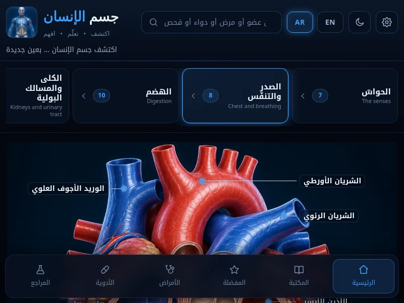

# Human Anatomy · جسم الإنسان

### 🔗 Live site · الموقع المباشر: **[anatomy.a7bdev.com](https://anatomy.a7bdev.com)**

[](https://anatomy.a7bdev.com) [](LICENSE)




An interactive, bilingual (English / Arabic RTL) human-anatomy explorer that runs
entirely in the browser — no backend, no build step, no tracking. Explore body
systems, organs and senses, browse a disease encyclopedia and a drug reference,
read first-aid guides, and look up common lab tests — all offline-capable and
free.

تطبيق تشريح تفاعلي ثنائي اللغة (إنجليزي / عربي RTL) يعمل بالكامل داخل المتصفّح —
بلا خادم، بلا خطوة بناء، وبلا تتبّع. استكشف أجهزة الجسم وأعضاءه وحواسّه، وتصفّح
موسوعة الأمراض ومرجع الأدوية، واقرأ أدلّة الإسعافات الأوّلية، وابحث في الفحوصات
المخبرية الشائعة — كل ذلك يعمل دون اتصال ومجّاناً.

## ✨ Features · المزايا

- **Interactive body explorer** — pan/zoom, front & back views, hundreds of
  labelled structures with short definitions on tap.
- **Disease encyclopedia** — concise, structured cards (overview, symptoms,
  cause, diagnosis, management, when to see a doctor), cross-linked to the
  relevant organs.
- **Drug reference** — searchable by generic and brand name, grouped by class.
- **Reference lab cards** — plain-language explanations of common lab tests.
- **First-aid guides** and a sectioned library across the whole app.
- **Bilingual** English / Arabic with full RTL, and **light / dark** themes.
- **Pure static** — vanilla HTML/CSS/JS, no framework, no backend, no cookies.

## 🚀 Run locally · التشغيل محلياً

It's just static files — serve the folder with any static server:

```bash
# Python
python3 -m http.server 8000
# or Node
npx serve .
```

Then open `http://localhost:8000`. You can also host it on any static host
(GitHub Pages, Netlify, Cloudflare Pages, nginx, …).

## 🩺 Medical disclaimer · إخلاء مسؤولية طبية

This application is for **education and general information only**. It is **not a
substitute for professional medical advice, diagnosis, or treatment**. Always
consult a qualified healthcare provider, and in an emergency contact your local
emergency services.

هذا التطبيق **للتعليم والمعلومات العامة فقط**، وهو **ليس بديلاً عن الاستشارة
الطبية أو التشخيص أو العلاج**. راجع دائماً طبيباً مختصاً، وفي الطوارئ اتصل بخدمات
الطوارئ المحلية.

## 📄 License · الرخصة

Released under the [MIT License](LICENSE).
